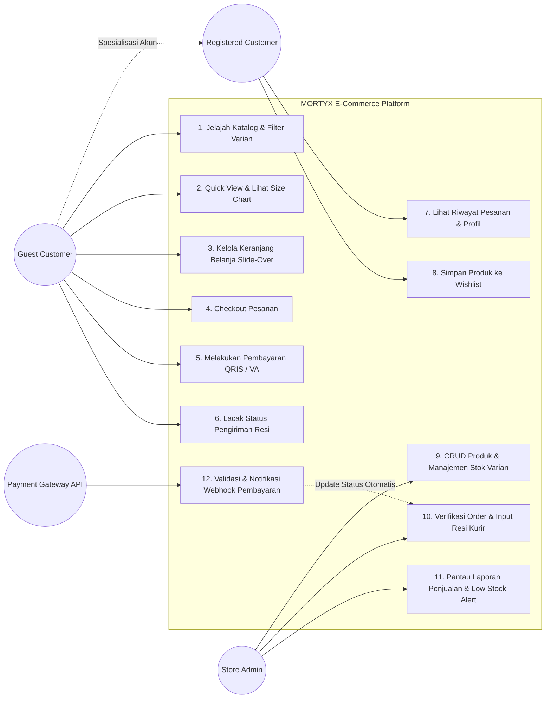
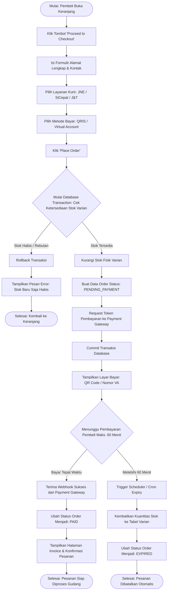
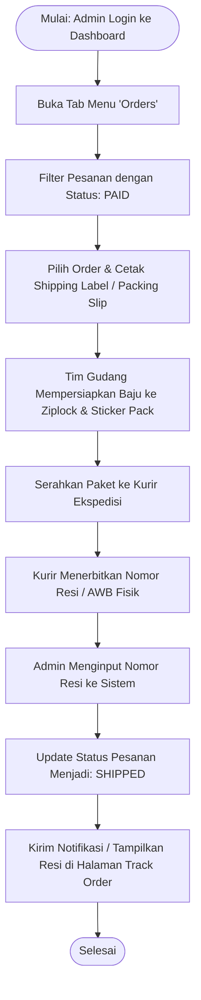
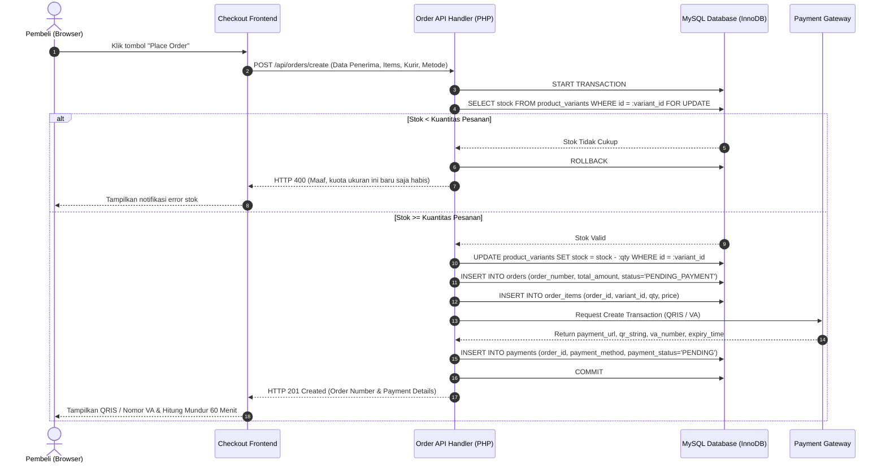
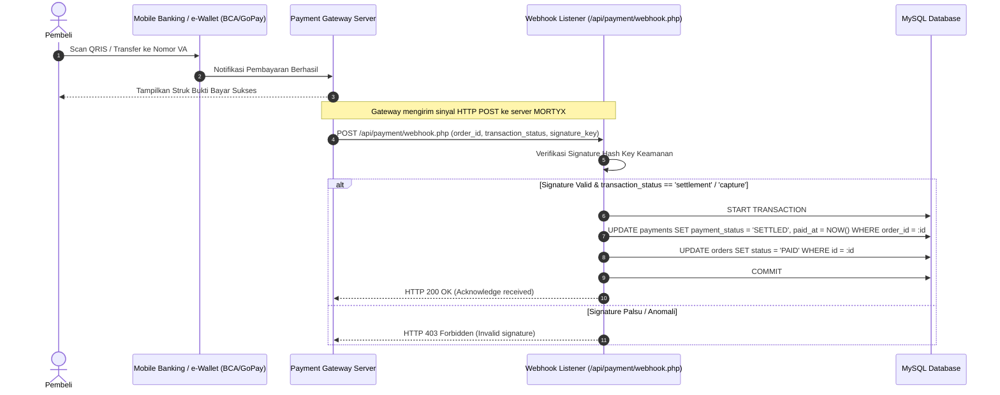
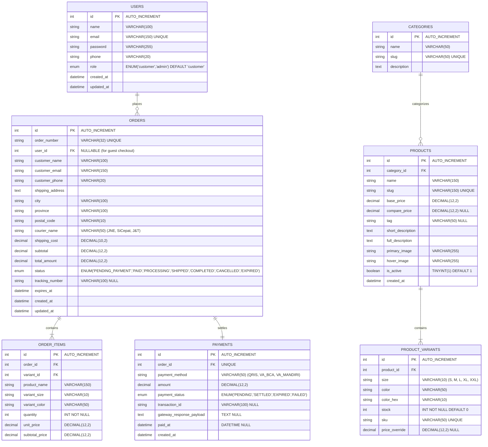
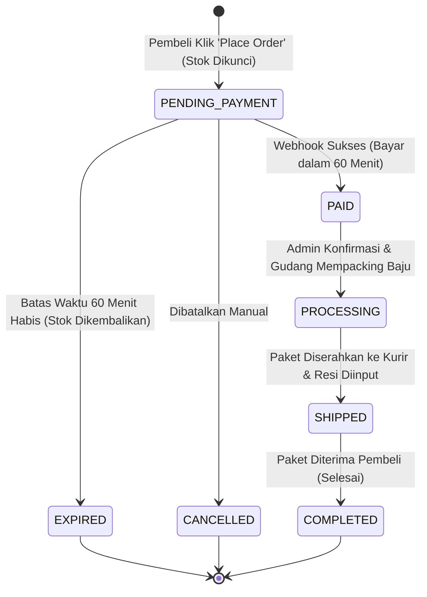

# UNIFIED MODELING LANGUAGE (UML) DIAGRAMS
## MORTYX — Official Apparel E-Commerce Architecture

Dokumen ini memuat diagram visual arsitektur sistem perangkat lunak MORTYX dengan standar pemodelan UML menggunakan sintaks Mermaid.

---

## 1. Use Case Diagram

Diagram ini memetakan interaksi fungsional antara aktor utama (**Guest Customer**, **Registered Customer**, **Store Admin**, dan **Payment Gateway**) dengan batasan sistem MORTYX.

---

## 2. Activity Diagrams

### 2.1 Alur Checkout, Validasi Stok & Pembayaran (Customer Journey)

---

### 2.2 Alur Pemenuhan Pesanan oleh Admin (Fulfillment Workflow)

---

## 3. Sequence Diagrams

### 3.1 Sequence Pembuatan Pesanan & Atomic Stock Reservation

---

### 3.2 Sequence Webhook Notifikasi Pembayaran & Settlement

---

## 4. Entity-Relationship Diagram (ERD & Class Schema)

Diagram struktur basis data relasional (*relational database schema*) yang dirancang untuk mendukung performa tinggi, integritas referensial, dan pencatatan audit order.

---

## 5. State Machine Diagram: Siklus Hidup Pesanan (Order Lifecycle)

